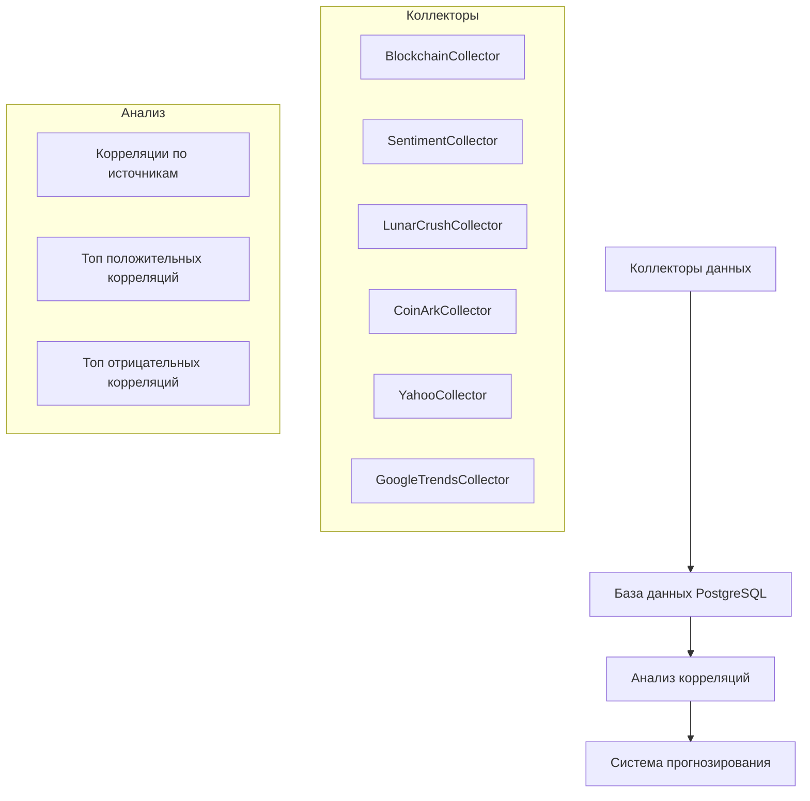

# Архитектура системы сбора и анализа данных

## Общая структура



## Общий обзор

Проект представляет собой систему сбора и анализа данных для предсказания цены Bitcoin. Система построена по модульному принципу, где каждый модуль отвечает за работу с определенным типом данных. Все данные хранятся в PostgreSQL базе данных для обеспечения надежности, быстрого доступа и удобства анализа.

## Компоненты системы

### 1. Коллекторы данных

#### BlockchainDataCollector (v2)
- **Метрики**: 
  - Рыночные (цена, капитализация, объем)
  - Майнинг (доход майнеров, сложность)
  - Сетевые (транзакции, адреса)
- **Частота**: каждые 8 часов
- **Особенности**: автозаполнение пропусков, интерполяция

#### SentimentDataCollector
- **Метрики**: 
  - Индекс страха и жадности
  - Анализ настроений
- **Частота**: ежедневно
- **Особенности**: классификация настроений

#### LunarCrushCollector
- **Метрики**: 
  - Социальные метрики
  - Рыночные метрики
  - Новостные метрики
  - Метрики влиятельных лиц
- **Частота**: ежедневно
- **Особенности**: анализ социальных сетей

#### CoinArkCollector
- **Метрики**: 
  - Фьючерсы
  - Деривативы
  - Long/Short позиции
- **Частота**: каждый час
- **Особенности**: анализ позиций

#### YahooFinanceCollector
- **Метрики**: 
  - Криптокомпании (MSTR, COIN, MARA, RIOT)
  - Индексы (SPY, QQQ, GLD, UUP)
- **Частота**: ежедневно
- **Особенности**: корпоративные события

#### GoogleTrendsCollector
- **Метрики**: 
  - Поисковые тренды
  - Региональные данные
- **Частота**: ежедневно
- **Особенности**: нормализация данных

### 2. База данных

#### Таблицы PostgreSQL
```sql
-- Blockchain данные
blockchain_metrics (
    timestamp TIMESTAMP,
    metric_name VARCHAR,
    value FLOAT
)

-- Sentiment данные
sentiment_metrics (
    timestamp TIMESTAMP,
    metric_name VARCHAR,
    value FLOAT
)

-- LunarCrush данные
lunarcrush_metrics (
    timestamp TIMESTAMP,
    metric_type VARCHAR,
    value FLOAT
)

-- CoinArk данные
coinark_metrics (
    timestamp TIMESTAMP,
    symbol VARCHAR,
    metric_name VARCHAR,
    value FLOAT
)

-- Yahoo Finance данные
yahoo_metrics (
    timestamp TIMESTAMP,
    symbol VARCHAR,
    metric_name VARCHAR,
    value FLOAT
)

-- Google Trends данные
google_trends_metrics (
    timestamp TIMESTAMP,
    keyword VARCHAR,
    value FLOAT
)

-- Корреляции
correlations (
    timestamp TIMESTAMP,
    metric1 VARCHAR,
    metric2 VARCHAR,
    correlation FLOAT
)
```

### 3. Система анализа

#### Корреляционный анализ
- Анализ всех метрик со всех коллекторов
- Группировка по источникам данных
- Топ-10 положительных и отрицательных корреляций
- Автоматическое заполнение пропусков

#### Особенности анализа
- Нормализация данных
- Обработка выбросов
- Интерполяция пропущенных значений
- Агрегация по различным временным окнам

### 4. Мониторинг и логирование

#### Система логов
- Детальные логи каждого коллектора
- Отслеживание ошибок и предупреждений
- Статистика сбора данных

#### Мониторинг данных
- Проверка целостности
- Контроль пропусков
- Валидация значений

### 5. Резервное копирование

#### Бэкапы базы данных
- Ежедневные полные бэкапы
- Инкрементальные бэкапы каждые 4 часа
- Версионирование схемы данных

#### Архивация данных
- Архивация исторических данных
- Сжатие старых данных
- Ротация логов

## Процесс обновления данных

1. Исторический коллектор инициализирует все коллекторы
2. Каждый коллектор проверяет последние данные в БД
3. Собираются только новые данные
4. Данные сохраняются в соответствующие таблицы
5. Запускается корреляционный анализ
6. Результаты анализа сохраняются и логируются

## Обработка ошибок

1. Автоматические повторные попытки при сбоях API
2. Логирование всех ошибок с контекстом
3. Уведомления о критических ошибках
4. Восстановление после сбоев

## Масштабирование

### Горизонтальное масштабирование
- Разделение коллекторов по серверам
- Репликация базы данных
- Балансировка нагрузки

### Вертикальное масштабирование
- Оптимизация запросов
- Индексирование данных
- Партиционирование таблиц
